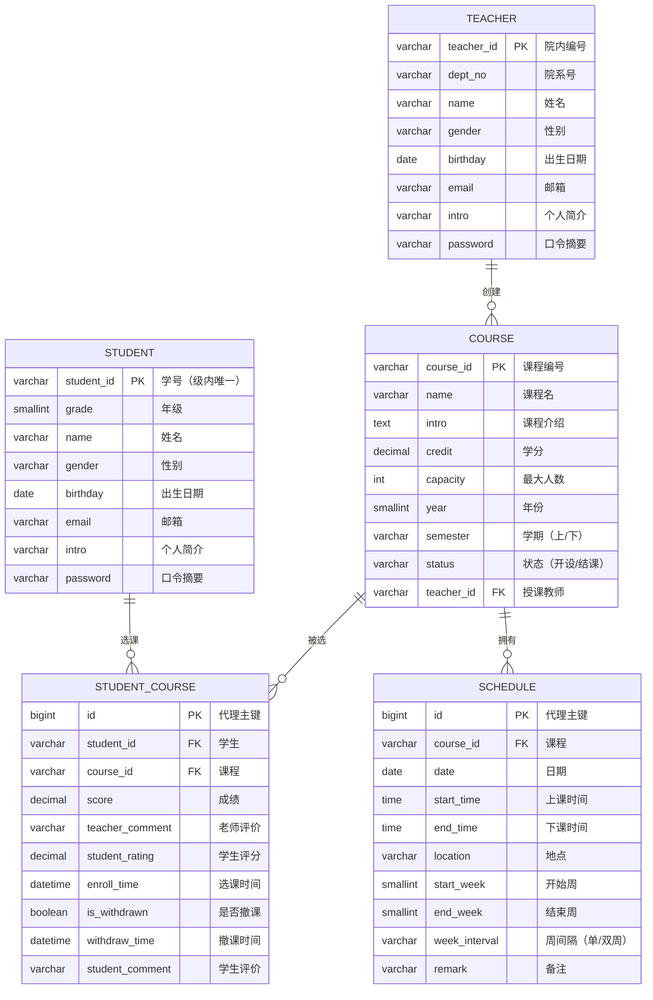

# 学生选课管理系统 · 课程设计归档

> 本科《空间数据库》课程设计 —— 一个基于 Django + MySQL 的选课管理网站。
> 本仓库归档**需求分析、系统设计与数据库建模文档**，不含可运行源代码。

---

## ⚠️ 关于本仓库（请先读这里）

**源代码已遗失。** 项目完成后，原始工程目录（Django 项目、模板、静态文件、建库脚本）在一次设备迁移中丢失，本地与云端备份均未留存。

因此本仓库**只保留设计文档与过程截图**，不给出一条 `pip install` 就能跑起来的路径。它能被查验的是这样三件事：

| 能证明 | 不能证明 |
| --- | --- |
| 从一句模糊需求到 5 张表、4 个实体关系、2 类角色的完整拆解过程 | 代码写得怎么样、工程规范如何 |
| 关系型建模能力：M:N 关系拆解、关系属性承载、状态位与软删除、时间维度建模 | 框架熟练度、Django ORM / 模板 / 中间件的实际运用 |
| 文档化习惯：需求 → 概念模型 → 逻辑模型 → 实现验证的闭环 | 系统性能、并发处理、线上运维经验 |

之所以仍然公开，是因为**「代码丢了」不等于「设计过程不存在」**。设计文档里的取舍判断，恰好是简历上最难被证伪、也最难被模仿的部分。

📄 完整报告：[PDF 版（60 页，可直接在线看）](https://cdn.jsdelivr.net/gh/xiaohuajia2005/course-selection-system-design@main/docs/course-design-report.pdf) · [DOCX 原件](https://github.com/xiaohuajia2005/course-selection-system-design/blob/main/docs/course-design-report.docx)（《空间数据库课程设计实践报告》，2025 年 6 月）

---

## 项目背景

课程设计要求在两周内完成一个"结构完整、可演示"的数据库应用系统：自行选题、自行建模、自行实现，并提交设计报告。选题定为**学生选课管理系统**，原因很直接——它的业务密度高而规则清晰：

- **多角色**：学生与教师看到的是同一个系统的两面，权限边界明确；
- **多对多**：学生与课程天然是 M:N，且这段关系本身携带成绩、评价等属性；
- **有时间维度**：一门课会在一个学期内按周次、星期、节次重复发生；
- **有状态流转**：课程从"开设"到"结课"，选课从"已选"到"已撤"，都不是一条记录的一辈子。

这四点凑在一起，正好覆盖关系型数据库最核心的建模动作。

**技术选型**：Python + Django + MySQL。前端刻意不使用任何图片素材，背景与样式全部由 CSS 渐变与盒模型完成——既是约束，也是一种对"能否仅靠排版把界面做干净"的自我测试。

---

## 系统功能

### 角色与权限边界

| 能力 | 学生 | 教师 | 说明 |
| --- | :---: | :---: | --- |
| 注册 / 登录 / 修改个人信息 | ✅ | ✅ | 两套入口，同一套认证逻辑 |
| 按课程名 / 编号 / 学分检索课程 | ✅ | ✅ | 课程列表页的搜索栏 |
| 选课 / 撤课 | ✅ | — | 撤课为状态位标记，不物理删除 |
| 查看当前课程 / 已结课程 / 课表 | ✅ | ✅ | 学生学习视图、教师任课视图 |
| 创建 / 编辑课程 | — | ✅ | 课程名、介绍、学分、最大人数、年份、学期 |
| 维护课程时刻表 | — | ✅ | 日期、起止时间、地点、起止周、周间隔 |
| 学生给教师评分 / 评价 | ✅ | — | 评教（学生 → 教师） |
| 教师给学生打分 / 评语 | — | ✅ | 评教（教师 → 学生） |

### 业务流程

注册 → 登录 → 按角色分流（教师端 / 学生端）→ 进入课程列表页 → 分流到创建课程、课程详情、个人信息、搜索、当前课程、已结课程、选课、撤课等操作。


### 功能结构

系统在结构上拆为五块：用户管理、课程管理、选课管理、统计分析、系统管理。


> 说明：上图中的「统计分析」「系统管理」是设计阶段规划的完整功能域，课程设计期间实际交付的是用户管理、课程管理、选课管理三条主线。保留原图，是为了让设计意图与实现范围的区别一目了然。

### 界面

登录页：角色化入口（"我是学生 / 我是老师"），纯 CSS 渐变背景。


注册页：年级、姓名、密码、确认密码、性别、生日、邮箱、个人简介（250 字上限）。

> 截图中密码、生日、邮箱三项已打码，报告封面学号亦已隐去——公开仓库不做个人信息留痕。


选课页：课程编号 / 名称 / 学分 / 当前人数·最大人数 / 年份 / 学期 / 教师 / 上课时间，一行一课一按钮。


课程详情：把课程、教师、时间地点、成绩、评语、评分收敛在一页。


已结课程：得分、评语、学生评分、学生评价并列展示，构成评教的双向闭环。


教师端：创建课程（课程名、介绍、学分、最大人数、年份、学期）。


教师端：给分（成绩 + 老师评价）。


---

## 数据库设计

### 概念模型（E-R 图）

四个实体、四个联系：教师 **创建** 课程（1:n）、学生 **选课** 课程（1:n，经 `学生课程` 落地）、课程 **对应** 学生课程（1:n）、课程 **拥有** 时刻表（1:n）。


同一模型的可读版本：



### 逻辑模型（关系模式）

```
学生(学号, 姓名, 性别, 出生日期, 年级, 邮箱, 简介, 密码)
教师(院内编号, 院系号, 姓名, 性别, 出生日期, 邮箱, 简介, 密码)
课程(编号, 课程名, 介绍, 学分, 最大人数, 年份, 学期, 状态, 教师编号)
学生课程(学号, 课程编号, 成绩, 老师评价, 学生评分, 选课时间,
        是否撤课, 撤课时间, 学生评价)
时刻表(编号, 课程编号, 日期, 上课时间, 下课时间, 地点,
      开始周, 结束周, 周间隔, 备注)
```

### 表结构

> 字段类型为按 Django ORM 常规映射反推的**推定结果**（原始 `models.py` 已遗失），字段语义与约束来源于 E-R 图与报告原文。

#### 1. `student` 学生表

| 字段 | 类型 | 约束 | 说明 |
| --- | --- | --- | --- |
| `student_id` | VARCHAR(20) | PK | 学号（级内学号），登录账号 |
| `grade` | SMALLINT | NOT NULL | 入学年级，如 2023 |
| `name` | VARCHAR(50) | NOT NULL | 姓名 |
| `gender` | VARCHAR(4) | — | 男 / 女 |
| `birthday` | DATE | — | 出生日期 |
| `email` | VARCHAR(100) | UNIQUE | 邮箱 |
| `intro` | VARCHAR(250) | — | 个人简介，250 字上限 |
| `password` | VARCHAR(128) | NOT NULL | 口令摘要（不存明文） |

#### 2. `teacher` 教师表

| 字段 | 类型 | 约束 | 说明 |
| --- | --- | --- | --- |
| `teacher_id` | VARCHAR(20) | PK | 院内编号，登录账号 |
| `dept_no` | VARCHAR(20) | — | 院系号 |
| `name` | VARCHAR(50) | NOT NULL | 姓名 |
| `gender` | VARCHAR(4) | — | 男 / 女 |
| `birthday` | DATE | — | 出生日期 |
| `email` | VARCHAR(100) | UNIQUE | 邮箱 |
| `intro` | VARCHAR(250) | — | 个人简介 |
| `password` | VARCHAR(128) | NOT NULL | 口令摘要 |

#### 3. `course` 课程表

| 字段 | 类型 | 约束 | 说明 |
| --- | --- | --- | --- |
| `course_id` | VARCHAR(20) | PK | 课程编号 |
| `name` | VARCHAR(100) | NOT NULL | 课程名 |
| `intro` | TEXT | — | 课程介绍 |
| `credit` | DECIMAL(3,1) | NOT NULL | 学分 |
| `capacity` | INT | NOT NULL, DEFAULT 60 | 最大人数（容量上限） |
| `year` | SMALLINT | NOT NULL | 开课年份 |
| `semester` | VARCHAR(4) | NOT NULL | 学期：上 / 下 |
| `status` | VARCHAR(10) | NOT NULL | 状态：开设 / 结课 |
| `teacher_id` | VARCHAR(20) | FK → `teacher` | 授课教师，`ON DELETE RESTRICT` |

#### 4. `student_course` 学生课程表（选课记录 + 成绩 + 评价）

| 字段 | 类型 | 约束 | 说明 |
| --- | --- | --- | --- |
| `id` | BIGINT | PK, AUTO_INCREMENT | 代理主键 |
| `student_id` | VARCHAR(20) | FK → `student` | 选课学生 |
| `course_id` | VARCHAR(20) | FK → `course` | 所选课程 |
| `score` | DECIMAL(5,1) | NULL | 成绩，未评分时为 `NULL` |
| `teacher_comment` | VARCHAR(255) | NULL | 教师评语 |
| `student_rating` | DECIMAL(3,1) | NULL | 学生对教师的评分 |
| `enroll_time` | DATETIME | NOT NULL | 选课时间 |
| `is_withdrawn` | BOOLEAN | NOT NULL, DEFAULT 0 | 是否撤课 |
| `withdraw_time` | DATETIME | NULL | 撤课时间 |
| `student_comment` | VARCHAR(255) | NULL | 学生对课程/教师的评价 |

约束：`UNIQUE(student_id, course_id)` —— 同一学生对同一门课只允许一条选课记录，撤课后重新选课复用同一条记录（复位状态位），而非新增一行。

#### 5. `schedule` 时刻表

| 字段 | 类型 | 约束 | 说明 |
| --- | --- | --- | --- |
| `id` | BIGINT | PK, AUTO_INCREMENT | 代理主键 |
| `course_id` | VARCHAR(20) | FK → `course` | 所属课程，`ON DELETE CASCADE` |
| `date` | DATE | — | 具体日期（用于单次调课） |
| `start_time` | TIME | NOT NULL | 上课时间 |
| `end_time` | TIME | NOT NULL | 下课时间 |
| `location` | VARCHAR(100) | — | 上课地点，如"西二 305" |
| `start_week` | SMALLINT | NOT NULL | 起始周，如第 3 周 |
| `end_week` | SMALLINT | NOT NULL | 结束周，如第 10 周 |
| `week_interval` | VARCHAR(8) | — | 周间隔：每周 / 单周 / 双周 |
| `remark` | VARCHAR(255) | — | 备注 |

### 五个建模决策

写在这里的不是"我建了几张表"，而是**当时为什么这么建**。

1. **M:N 拆解，同时让关系承载属性。**
   学生与课程是多对多，但这段关系不是纯粹的存在性证明——它带着成绩、教师评语、学生评分、撤课状态。把 `student_course` 做成独立实体表，关系属性才有地方落脚，也才谈得上"一次选课 = 一条可追溯的生命周期记录"。

2. **撤课用状态位，不做物理删除。**
   `is_withdrawn` + `withdraw_time` 而非 `DELETE`。理由：撤课之后仍要能回答"这门课历史上多少人退过""该生是否曾选过又退掉"。硬删除会把这段历史一并抹掉，而这类历史恰恰是教务场景里最常被追问的数据。

3. **容量不冗余计数，用派生值。**
   `course.capacity` 只存上限，当前人数由 `COUNT(student_course WHERE course_id = ? AND is_withdrawn = 0)` 实时得出。牺牲一点查询开销，换掉一个必然会与事实不一致的冗余字段——课程设计的规模下，这个取舍明确划算。

4. **时间维度用"周次 + 星期 + 起止时间"，而不是一串具体日期。**
   `start_week / end_week / week_interval / date / start_time / end_time` 六个字段合起来，才足以表达"第 3 到第 10 周、每周三 08:00–09:50、西二 305、单双周交替"这种真实课表语义。若只存单个 `datetime`，一门课一学期要铺十几行，且单双周无法表达。

5. **主键混用业务键与代理键，各取所长。**
   学生、教师、课程用业务主键（学号 / 院内编号 / 课程编号）——它们本身有语义、天然唯一、便于人工核对；`student_course` 与 `schedule` 用自增代理键，因为二者都没有稳定的天然唯一键（同一门课一学期就是有多条时间条目）。

> 一处如实记录的不足：学生与教师各建一张表、各自持有 `password` 与 `email`，而不是抽象出统一的 `user` 表 + 角色字段。课程设计的规模下这样最省事，但代价是登录逻辑要写两遍、未来加"教务管理员"角色时改动面很大。这是当时**明知而选择**的简化。

---

## 技术栈

| 层次 | 选型 | 用途 |
| --- | --- | --- |
| 语言 | Python 3 | 后端主语言 |
| Web 框架 | Django | MTV 分层、URL 路由、模板渲染、ORM 映射 |
| 数据库 | MySQL | 关系存储，存放上述 5 张表 |
| ORM | Django ORM | 由模型类生成表结构、处理外键与查询 |
| 前端 | HTML + CSS | 页面结构；无图片素材，背景与样式全部由 CSS 完成 |
| 认证 | 自建会话式登录 | 学生 / 教师双入口，注册、登录、改密、改资料 |
| 环境 | 本地开发（Windows） | 单机部署，演示为主 |

选型说明：Django 自带 ORM 与模板层，能在两周内把"建模 → 建表 → 出页面"的链路打通；MySQL 与课程内容（空间数据库）同源，便于把课堂上讲的实体关系、范式、约束真正落到 DDL 上。

---

## 项目收获

**技术层面**
- 摸清了 Django 从模型定义到迁移建表、再到模板渲染的完整链路，理解 ORM 抽象与真实表结构之间的对应关系；
- 第一次有意识地做数据库优化：给外键与检索字段建索引、避免冗余计数、用派生查询替代重复存储；
- 前端在"零图片素材"的约束下靠 CSS 渐变、盒模型与 flex 排版把界面做干净。

**工程层面**
- **需求分析先行**：报告里"需求分析"一节前后改了四版，每次改动都会向下波及 E-R 图。这件事比任何一次调 bug 都更直观地说明了"上游一个含糊，下游十倍返工"。
- **文档本身是交付物**：写完报告再回头改模型，才发现图、表、文字三处对不上有多常见——一致性必须靠核对，不能靠记忆。

**专业认知**
- 教务系统的复杂不在功能数量，而在规则之间的耦合：容量、时间冲突、撤课、评教，任何两条规则相遇都会生出边界情况；
- 设计是取舍，不是寻找唯一正解。要不要拆 `user` 表、要不要冗余计数、要不要软删除——每个选择都能说清代价，才算真的做了设计；
- 可扩展性要提前想一层：这套表结构再加"多个教师合上同一门课""跨学期重修"就会吃力，而这两条在真实教务系统里几乎必然出现。

---

## 仓库结构

```
course-selection-system-design/
├── README.md                      # 本文件：背景、功能、建模、技术栈、收获
├── .gitignore                     # Python / Django / IDE / OS 忽略规则
└── docs/
    ├── course-design-report.docx  # 完整课程设计报告（原始交付物）
    ├── course-design-report.pdf   # 报告 PDF 版（60 页，便于在线阅读与检索）
    └── images/                    # 从报告中整理出的设计图与界面截图
        ├── 01-business-flow.png
        ├── 02-function-structure.jpeg
        ├── 03-er-diagram.png
        ├── 04-ui-login.png
        ├── 05-ui-register.png
        ├── 06-ui-course-list.png
        ├── 07-ui-course-detail.png
        ├── 08-ui-finished-courses.png
        ├── 09-ui-teacher-create-course.png
        └── 10-ui-teacher-grade.png
```

---

## 说明

- 报告为课程设计提交版本，仅作存档。**已做隐私处理**：封面学号以 `**********` 隐去；注册页截图中的密码、生日、邮箱已打码。姓名、专业、班级、任课教师保留原样，与本人公开简历一致。README 不复述任何身份信息。
- 本仓库为**求职作品集用途**归档，不包含也不声称包含任何可运行代码。若需要代码样例，请参见本人其他仓库。
- 报告中引用的第三方素材（校徽等）版权归原权利人所有，仅作课程存档使用。
- 文中图片与 PDF 通过 jsDelivr CDN 引用（`cdn.jsdelivr.net/gh/<user>/<repo>@main/...`）。原因：GitHub 的图片代理域名在部分网络环境下不可达，用相对路径会导致整页图片加载失败。若日后 CDN 不可用，把链接换回 `docs/images/<文件名>` 的相对路径即可，仓库内文件始终是唯一数据源。
